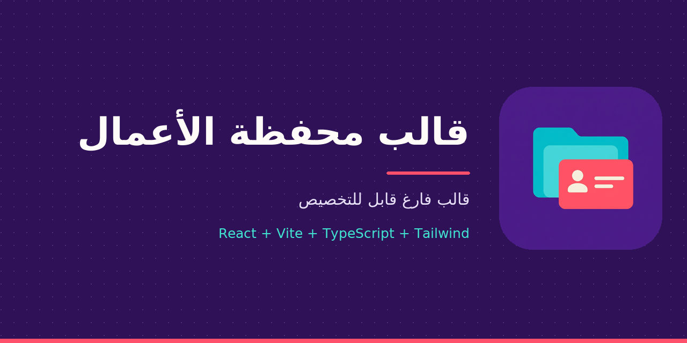

<p align="center">
  
</p>

# قالب محفظة الأعمال — Portfolio Template

<p align="center">
  
  
  
  
</p>

قالب **فارغ عمدًا** لتصميم محفظة أعمال لأي شخص أو مجال، مع دعم العربية وRTL. تُضبط البيانات والأقسام والمظهر من ملفات مركزية، مع الإبقاء على محرك العرض التقديمي والمختبرات الموروثة في أوضاع مستقلة.

> الصفحة الرئيسية لا تحتوي على اسم أو سيرة أو مشاريع أو بيانات تواصل افتراضية؛ ظهورها فارغة عند التشغيل مقصود، وليس عطلًا.

**[البداية السريعة](#البداية-السريعة)** · **[التخصيص](#تخصيص-المحفظة)** · **[الأوضاع والمختبرات](#الأوضاع-والمختبرات)** · **[بنية المشروع](#بنية-المشروع)** · **[الخصوصية والنشر](#الخصوصية-والنشر)**

---

## ما الذي يوفره القالب؟

- أقسام قابلة لإعادة الاستخدام: الهوية، النبذة، المشاريع وتفاصيلها وصورها الاختيارية، المهارات، الخبرة، التعليم، والتواصل.
- تحكم في ترتيب الأقسام وإظهارها وألوانها وخطوطها واتجاهها، دون إعادة بناء المحرك.
- تحقق يميّز بين البيانات **الفارغة** و**الجزئية** و**المكتملة**، مع إخفاء الأقسام الفارغة والروابط غير الصالحة.
- React وTypeScript وVite وTailwind، مع الخطوط المحلية ودعم العربية وتقليل الحركة.
- محرك الشرائح الأصلي وأدوات العرض والمؤثرات والرسوم والمختبرات؛ تُحمّل الأوضاع الثقيلة عند طلبها، وWebGL اختياري في المشاهد التي تدعمه.
- وثائق وقواعد ومهارات تساعد وكيل الذكاء الاصطناعي على تصميم محفظة لاحقًا دون اختلاق بيانات.

## البداية السريعة

يتطلب المشروع Node.js **22.12.0 أو أحدث من سلسلة 22، أو سلسلة 24 أو 26 فأحدث** وnpm:

```bash
npm ci
npm run dev
```

افتح الرابط الذي يعرضه Vite. الصفحة الرئيسية فارغة عمدًا؛ ولمعاينة مكونات المحفظة ببيانات اختبار اصطناعية افتح `?lab=portfolio`.

### الفحص والبناء

```bash
npm run check       # فهرس المكتبات + سلامة النسخة المحلية + TypeScript + الاختبارات + البناء
npm run ai:rules    # توليد تعليمات الوكلاء من .ruler/rules
npm run build       # بناء محلي في dist/، دون نشر
npm audit           # فحص أحدث تنبيهات الاعتمادات
```

لبناء الموقع تحت مسار فرعي، اضبط المسار الملائم لمضيفك قبل البناء:

```bash
BASE_PATH=/portfolio/ npm run build
```

إذا كانت بيئتك تحتاج شهادة جذر النظام ليتحقق Node من الاتصال، يمكن ضبط `NODE_EXTRA_CA_CERTS=/etc/ssl/certs/ca-certificates.crt` بحسب نظامك. لا تعطّل التحقق من TLS.

## تخصيص المحفظة

1. اجمع المحتوى والتصميم والصور والروابط المصرّح بها من صاحب المحفظة؛ لا تختلق أسماء أو نتائج أو مؤهلات.
2. عدّل البيانات وترتيب الأقسام وإعدادات الألوان واللغة والاتجاه والخطوط في **`src/data/portfolio/index.ts`**.
3. راجع العقود في `src/portfolio/types.ts` والمكونات وسجل الأقسام في `src/portfolio/Portfolio.tsx`.
4. استخدم `validatePortfolio` من `src/portfolio/validate.ts`، ثم شغّل `npm run check` وافحص التصميم على الشاشات الصغيرة ولوحة المفاتيح وRTL وتقليل الحركة.

الحقول الناقصة يمكن تركها فارغة. تعريف الاكتمال في المدقق جاهزية تقنية أدنى، وليس تأكيدًا لصحة المعلومات أو إذنًا بنشرها. للمزيد: [مواصفة القالب](docs/PORTFOLIO_TEMPLATE_SPEC.md) · [دليل الوكيل](docs/AI_PORTFOLIO_GUIDE.md).

## الأوضاع والمختبرات

| المسار | الاستخدام |
| --- | --- |
| `/` | المحفظة الافتراضية ببيانات فارغة |
| `?lab=portfolio` | معاينة المحفظة ببيانات اصطناعية معزولة عن البيانات الافتراضية |
| `?mode=presentation` | محرك العرض التقديمي الأصلي وبياناته المستقلة |
| `?lab=fonts` | الخطوط والاقترانات |
| `?lab=charts` | الرسوم البيانية |
| `?lab=cinematic` أو `?lab=flyover` | مشاهد وعروض سينمائية |
| `?lab=effects` أو `?lab=showreel` | المؤثرات والحركة |
| `?lab=presenter` أو `?lab=spotlight` أو `?lab=chalkboard` | الملاحظات والتركيز والسبورة |
| `?lab=distilbook` أو `?lab=simulations` | الحركة البحثية والمحاكاة |

توجد أيضًا الأسماء البديلة `notes` و`zoom` و`board` و`research` و`motion`. المختبر له أولوية عند الجمع بين `lab` و`mode`. قواعد المذكرات والشرائح تخص وضع العرض التقديمي فقط، لا المحفظة. راجع وثائق `docs/` لكل مختبر ومتطلباته.

## بنية المشروع

```text
src/
├── data/portfolio/         بيانات المحفظة وإعدادات تصميمها
├── portfolio/              العقود والمكونات والسجل والتحقق والمختبر
├── data/presentation.tsx   بيانات العرض الأصلي
├── components/             مكونات العرض والرسوم والمعرض
├── fonts/                  سجل الخطوط المحلية وتحميلها
├── recipes/                وصفات الحركة والمؤثرات
└── __tests__/              اختبارات القالب والمكونات

docs/                       المواصفات والأدلة وفهرس المكتبات
.agents/skills/             مهارات الوكلاء، ومنها portfolio-template-design
.ruler/rules/               مصادر تعليمات الوكلاء
.github/workflows/          الفحص والبناء اليدوي دون نشر
.github/social-preview.png  صورة تعريفية للمستودع
public/                     الشعار والأيقونات وإشعارات التراخيص
vendor/                     نسخة الإضافة الأصلية المحلية وإثبات سلامة ملفاتها
```

## الوثائق والمهارات

- [مواصفة قالب المحفظة](docs/PORTFOLIO_TEMPLATE_SPEC.md) و[دليل تصميم المحفظة للوكيل](docs/AI_PORTFOLIO_GUIDE.md).
- [بحث المكتبات المقترحة](docs/PORTFOLIO_LIBRARY_RESEARCH.md) و[مكتبات المحفظة](docs/PORTFOLIO_LIBRARIES.md) و[الخطوط والطباعة](docs/TYPOGRAPHY.md) و[الفهرس الكامل للمكتبات](docs/PROJECT_LIBRARIES.md).
- [مواصفة العرض الأصلي](docs/PRESENTATION_TEMPLATE_SPEC.md) و[توجيه عروض المذكرات](docs/THESIS_PRESENTATION_ROUTER.md).
- [مراجعة أمن الاعتمادات](docs/SECURITY_DEPENDENCIES.md) وشرح النسخة المحلية للإضافة.
- [مهارة تصميم المحفظة](.agents/skills/portfolio-template-design/SKILL.md). عدّل قواعد `.ruler/rules/` ثم شغّل `npm run ai:rules` بدل تحرير ملفات التعليمات المولّدة يدويًا.

## الخصوصية والنشر

**لا يوجد نشر تلقائي أو موقع عام معدّ مسبقًا.** سير العمل `deploy.yml` يفحص البناء يدويًا فقط، ولا يرفع ملفًا أو ينشر موقعًا. اختر استضافة خاصة مع مصادقة وتحكم في الوصول، واطلب موافقة المالك قبل النشر.

خصوصية مستودع GitHub لا تجعل الموقع المنشور خاصًا تلقائيًا؛ لا تستخدم GitHub Pages للبيانات الحساسة. قد تتضمن حزمة الإنتاج ملفات المختبرات والأصول الموروثة، لذلك لا تضع فيها أسرارًا. افحص أذونات المشاريع والصور والروابط قبل إضافتها.

الشعار الجديد في `public/portfolio-logo.png`، وصورة المستودع في `.github/social-preview.png`. ظهور الصورة في README لا يضبط صورة المشاركة على GitHub تلقائيًا؛ تُرفع من إعدادات المستودع عند الاتفاق على مستودع مناسب.

## أمن الاعتمادات

في آخر فحص محلي بتاريخ 2026-11-03 أظهر `npm audit` **صفر تنبيهات** بعد معالجة تنبيهات المصدر. النتيجة تتغير مع قاعدة البيانات ولا تغطي كل المخاطر أو الملفات البرمجية المضمّنة. انظر [التفاصيل والحدود](docs/SECURITY_DEPENDENCIES.md)، وشغّل الفحص مجددًا قبل النشر.

## المصدر والتراخيص

نُسخت الملفات المتتبعة من [powerpoint](https://github.com/exposiaservices-dot/powerpoint) عند الالتزام `c53a68efe051ed17c236e3df64a5663f3788a3bc` دون تاريخ Git أو اعتمادات مثبتة أو أسرار. محفوظان أيضًا شعار المصدر في `public/logo.png` وصورة معاينته في `assets/upstream/powerpoint-social-preview.png`.

بقيت إشعارات التراخيص والإسناد الخارجية، ومنها `public/licenses/` و`src/components/{charts,gallery}/LICENSES/` و`assets/algerian-universities/source/`. لم يُعثر على ترخيص شامل في جذر المصدر؛ راجع الأذونات وتراخيص الأصول قبل إعادة التوزيع أو النشر. أُضيفت `zod` (MIT) لفحص البيانات و`yet-another-react-lightbox` (MIT) لصور المشاريع و`axe-core` (MPL-2.0) لاختبارات الوصول؛ راجع [فهرس المكتبات](docs/PROJECT_LIBRARIES.md).
